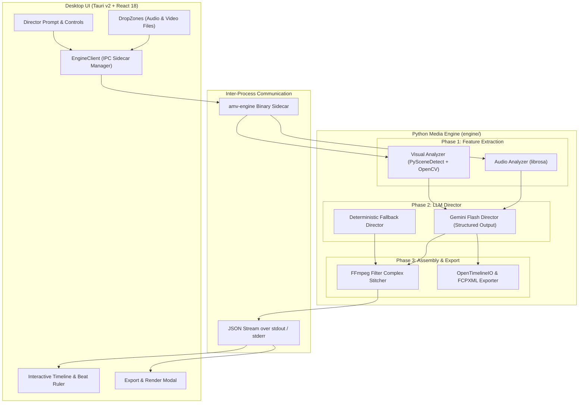
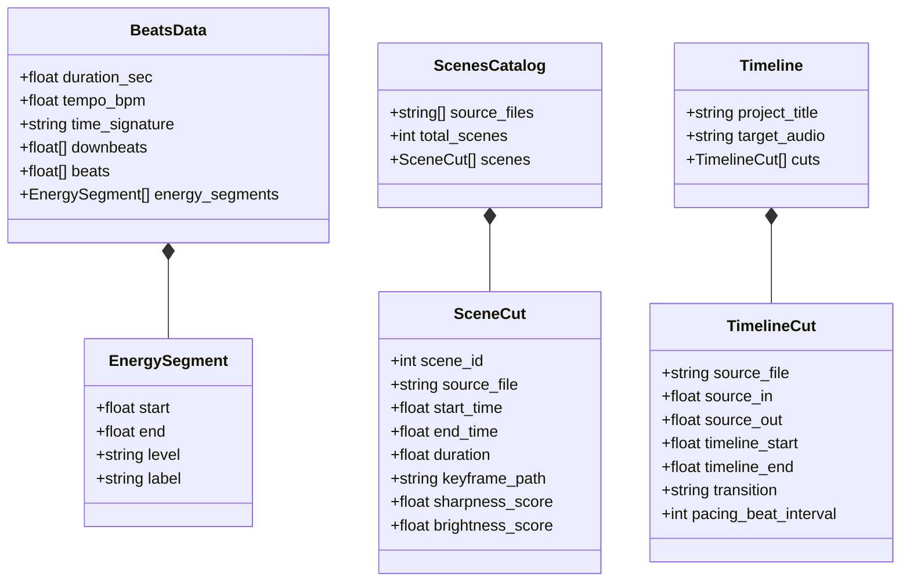

# AMV Maker: Architecture & Technical Specification

## Overview

AMV Maker is an automated Anime Music Video production workstation designed to generate professional, beat-synchronized video edits from raw source video clips and audio tracks.

The platform is designed around three fundamental core principles:
1. **Deterministic Timing**: Audio beats and visual cuts align using millisecond-accurate mathematical markers rather than approximate frame sleep loops.
2. **Local Processing for Heavy Media**: Raw high-bitrate media (HEVC/H.264 video, FLAC/WAV audio) stays on the user's workstation. Only low-resolution keyframes, metadata, and mathematical timestamps are passed to cloud LLM APIs.
3. **Decoupled Architecture**: The media analysis engine (Python CLI/sidecar) is decoupled from the user interface (Tauri v2 / React / TypeScript). Communication occurs via typed JSON schemas over standard input/output (IPC) and standard process exit codes.

---

## High-Level System Architecture



---

## The 3-Phase Deterministic Pipeline

### Phase 1: Local Media Feature Extraction

#### 1. Audio Beat & Energy Analysis (`engine/audio_analyzer.py`)
- **Librosa Processing**: Ingests audio files (`.wav`, `.mp3`, `.flac`, `.aac`) and computes:
  - Tempo (BPM) via onset envelope auto-correlation.
  - Beat timestamps via dynamic programming beat tracking.
  - Bar downbeats (`4/4` metric alignment by default, detecting measure starts).
- **RMS Energy Segmentation**: Divides the audio into temporal segments (e.g., 2-second analysis windows), computing Root Mean Square (RMS) energy. Quantizes energy into levels: `low`, `medium`, `high`, `drop`, `intro`, `outro`, and `build`.
- **Output Artifact**: `beats.json` matching `BeatsData` schema.

#### 2. Visual Scene Cut Detection & Keyframing (`engine/visual_analyzer.py`)
- **PySceneDetect**: Uses `ContentDetector` (default threshold: 27.0) to identify natural cinematic scene boundaries in source footage.
- **Keyframe Extraction**: Extracts keyframe images at the midpoint of every detected cut, resized to 320px width thumbnails saved to `cache/thumbnails/`.
- **Image Metrics (OpenCV)**:
  - Sharpness score calculated via Laplacian variance ($\sigma^2$).
  - Brightness score calculated via average HSV value channel ($\mu_V$).
- **Output Artifact**: `scenes.json` matching `ScenesCatalog` schema.

---

### Phase 2: Director Orchestration & Cut Alignment

#### 1. Cloud LLM Director (`engine/director.py`)
- Ingests `beats.json`, `scenes.json`, and the user's creative prompt.
- Invokes **Google Gemini 2.0 Flash / 1.5 Flash** using strict JSON output schemas (`response_schema=Timeline`).
- Ensures that:
  1. Cut boundaries snap exactly to detected beat timestamps.
  2. High-energy sections (chorus, drop) receive high-sharpness, fast-moving scenes.
  3. Transitions (`cut`, `crossfade`, `flash_white`, `zoom_in`, `whip_pan`) match musical dynamics.
  4. Timeline coverage is contiguous without gaps or negative durations.

#### 2. Deterministic Fallback Director (`direct_amv_deterministic`)
- Functions entirely offline without requiring network access or `GEMINI_API_KEY`.
- Partitions timeline duration by musical downbeats and energy segments.
- Programmatically matches scene sharpness and duration to dynamic energy profiles.
- **Output Artifact**: `timeline.json` matching `Timeline` schema.

---

### Phase 3: Assembly, Video Stitching & NLE Export

#### 1. Deterministic FFmpeg Stitcher (`engine/stitcher.py`)
- Generates a single-pass `filter_complex` execution graph in FFmpeg:
  - `trim`: Extracts the exact subclip from each source video.
  - `setpts=PTS-STARTPTS`: Resets presentation timestamps to zero for jitter-free alignment.
  - `scale` and `pad`: Uniformly normalizes source footage to target resolution (e.g. 1920x1080) with centered letterboxing/pillarboxing.
  - `setsar=1`: Sets square pixel aspect ratio.
  - `fps`: Conforms video streams to target frame rate (e.g. 24 fps).
  - `split`: Automatically splits repeated scene streams to prevent DAG edge collisions in FFmpeg.
  - `concat`: Concatenates all visual streams seamlessly.
- **Hardware Acceleration**:
  - macOS: `h264_videotoolbox` hardware encoder with automatic fallback to software `libx264`.
  - Linux/Windows: `libx264` with configurable encoding presets (`ultrafast`, `fast`, `medium`, `slow`).
- **Real-Time Progress**: Emits line-by-line machine-readable JSON progress events (`type: progress`, `percent`, `fps`, `speed`) over standard output.
- **Output Artifact**: `export/amv_final.mp4` (H.264 video + AAC audio).

#### 2. Professional NLE Interchange Exporters (`export_project`)
- **OpenTimelineIO (`.otio`)**:
  - Full multitrack timeline representation containing audio track and video cuts.
  - Compatible with **DaVinci Resolve**, **Adobe Premiere Pro**, and **Final Cut Pro**.
- **Final Cut Pro XML (`.fcpxml`)**:
  - Native FCPXML v1.9 schema with format definitions, asset libraries, spine clips, and gap alignment.
  - Ready for color grading and finishing in **Final Cut Pro X**.

---

## Data Contracts (Schema Specifications)

All communication between Python and TypeScript adheres to the JSON schema defined in `specs/schemas.json`.



---

## Inter-Process Communication (IPC) Protocol

The Tauri v2 frontend invokes the Python sidecar as a child process via `@tauri-apps/plugin-shell`.

### Command Line Interface Specification

| CLI Subcommand | Purpose | Primary Inputs | Stdout Output |
| :--- | :--- | :--- | :--- |
| `analyze-soundtrack` | Extract BPM & beats | `<audio_path>` | `BeatsData` JSON |
| `analyze-scenes` | Visual scene detection | `<video_dir> [--thumbs]` | `ScenesCatalog` JSON |
| `direct` | AI AMV direction | `--beats --scenes --prompt` | `Timeline` JSON |
| `render` | FFmpeg video stitch | `<timeline_file> --output [--json]` | Streaming progress JSON & result |
| `export-project` | OTIO / FCPXML export | `<timeline_file> --output --format` | Export confirmation JSON |

### Streaming Render Progress Protocol

When `--json` is specified, `render` emits newline-delimited JSON objects to standard output:

```json
{"type": "progress", "percent": 42.5, "currentTime": 6.38, "totalTime": 15.0, "fps": 58.4, "speed": "2.4x", "frame": 153}
```

Upon successful completion:
```json
{"type": "completed", "status": "success", "outputPath": "/path/to/amv_final.mp4", "duration": 15.0}
```

If an encoding error occurs:
```json
{"type": "error", "status": "failed", "error": "Description of FFmpeg error"}
```

---

## Sidecar Packaging & Bundling

Tauri sidecars require platform-specific binary naming conventions:
- `amv-engine-aarch64-apple-darwin` (Apple Silicon macOS)
- `amv-engine-x86_64-apple-darwin` (Intel macOS)
- `amv-engine-x86_64-unknown-linux-gnu` (x86_64 Linux)
- `amv-engine-x86_64-pc-windows-msvc.exe` (Windows)

The repository provides `scripts/bundle_sidecar.sh` to package or link the Python engine into `app/src-tauri/binaries/` ensuring seamless execution in both development and production builds.
