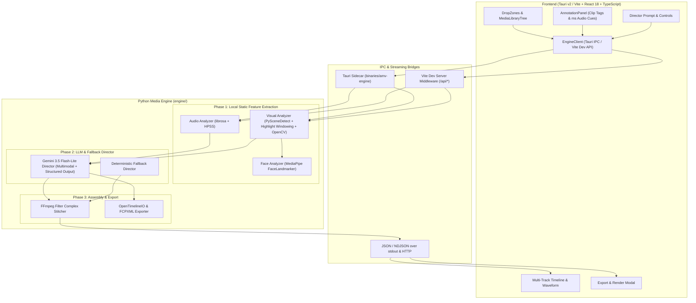
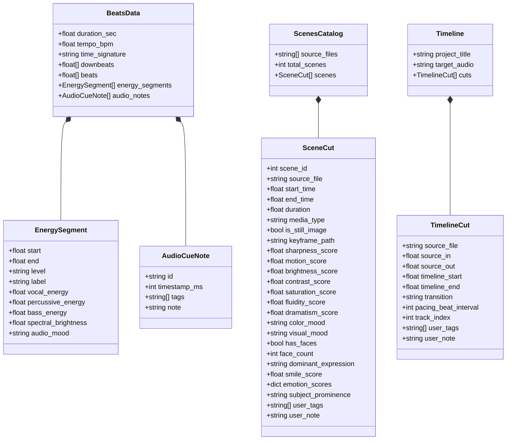

# AMV Maker: Architecture & Technical Specification

## Overview

AMV Maker is a universal, beat-synchronized visual storytelling and music video studio that crafts rhythm-locked edits from any combination of raw video clips, still photos, and music tracks—supporting life milestones (weddings, children growing up, birthdays), travel recaps, and high-energy AMVs/action reels.

The platform is built around four core principles:
1. **Deterministic Timing**: Audio beats, millisecond-level audio cue notes, and visual cuts align using exact timestamps rather than approximate sleep loops.
2. **Local Processing for Heavy Media**: Raw high-bitrate media (HEVC/H.264 video, high-res photos, FLAC/WAV/MP3 audio) stays local. Only typed metadata, manual tags/notes, mathematical timestamps, and low-resolution 480px JPEG keyframes are passed to cloud LLM APIs.
3. **Decoupled Architecture**: The media analysis engine (Python CLI/sidecar) is strictly decoupled from the user interface (Tauri v2 / React / TypeScript). Communication occurs via typed JSON/NDJSON schemas matching `specs/schemas.json`.
4. **Human-in-the-Loop Direction**: Users can inspect and override every stage—tuning highlight windowing parameters per video, tagging/noting clips and photos, placing millisecond-accurate audio cue markers, and manually editing multi-track timeline cuts.

---

## High-Level System Architecture

---

## The 3-Phase Deterministic Pipeline

### Phase 1: Local Media Feature Extraction

#### 1. Audio Beat, Band Energy & Mood Analysis (`engine/audio_analyzer.py`)
- **Librosa Beat Tracking**: Ingests `.wav`, `.mp3`, `.flac`, `.m4a`, `.aac`, `.ogg`, `.opus` and computes BPM, beat timestamps, and `4/4` bar downbeats.
- **Harmonic-Percussive & Band Energy (per 2s `EnergySegment`)**:
  - Uses `librosa.effects.hpss(y)` and STFT band filtering to extract normalized `[0.0, 1.0]` scores for:
    - `vocal_energy` (harmonic energy in `300–3400 Hz`)
    - `percussive_energy` (percussive RMS energy)
    - `bass_energy` (`20–250 Hz` low-end energy)
    - `spectral_brightness` (normalized `librosa.feature.spectral_centroid`)
  - Classifies `audio_mood` (`vocal_intimate`, `vocal_soaring`, `instrumental_calm`, `rhythmic_groove`, `high_energy_drop`, `dramatic_build`) alongside RMS `level` (`low`, `medium`, `high`, `drop`, `intro`, `outro`, `build`).
- **Millisecond Audio Cue Notes**: Users can attach `AudioCueNote` markers (`timestamp_ms`, `tags`, `note`) directly to `BeatsData.audio_notes`.

#### 2. Visual Scene Detection, Highlight Windowing & Mood Analysis (`engine/visual_analyzer.py`, `engine/face_analyzer.py`)
- **PySceneDetect + Visual Highlight Windowing**:
  - Uses `ContentDetector` (configurable `--threshold`, default `27.0`) to find hard camera cuts.
  - Subdivides long continuous takes (`> --max-scene-duration`, default `5.5s`) into non-overlapping highlight windows (`--target-window-duration` default `3.5s`, `--min-window-duration` default `2.0s`; scales down to `0.5s` quick cuts) scored by motion energy, sharpness, exposure, saturation, and MediaPipe face/smile peaks.
  - Supports `--stream` NDJSON output (`discovered`, `file_done`, `complete`) so raw assets appear in the library immediately and cuts populate progressively.
- **Optical Flow, Contrast & Visual Mood (OpenCV)**:
  - `sharpness_score` (Laplacian variance), `brightness_score` (grayscale mean), `motion_score` (`0–100`), `contrast_score` (`0–100`), `saturation_score` (`0–100`).
  - `fluidity_score` (`0–100`, video only): Farneback optical-flow (`cv2.calcOpticalFlowFarneback`) direction and magnitude consistency across sampled frames.
  - `dramatism_score` (`0–100`), `color_mood` (`warm_golden`, `cool_cinematic`, `vibrant_festive`, `moody_dark`, `neutral_balanced`), and `visual_mood` (`joyful_bright`, `energetic_action`, `dramatic_intense`, `serene_scenic`, `melancholic_muted`, `warm_intimate`).
- **Facial Emotion & Prominence (`engine/face_analyzer.py`)**:
  - Runs local MediaPipe `FaceLandmarker` (`engine/assets/face_landmarker.task`) across sampled frames to extract `has_faces`, `face_count`, `subject_prominence` (`close_up`, `medium_shot`, `wide_shot`, `scenic`), `smile_score`, `dominant_expression` (`laughing / ecstatic`, `joyful / smiling`, `surprised / amazed`, `angry / intense`, `sad / melancholic`, `worried / tense`, `focused / determined`, `calm / neutral`), and `emotion_scores` (`joy`, `surprise`, `anger`, `sadness`, `worry`, `neutral`).
- **Keyframes**: Saves `480px`-wide JPEG thumbnails to `cache/thumbnails/`.

---

### Phase 2: Director Orchestration & Cut Alignment

#### 1. Cloud LLM Director (`engine/director.py`)
- Uses `build_director_input(beats, catalog, user_prompt)` to assemble `BeatsData` (including `audio_cue_notes` with `timestamp_ms` and `timestamp_sec`, plus segment vocal/percussive/bass/mood fields), `ScenesCatalog` (all visual, fluidity, dramatism, emotion metrics, `user_tags`, and `user_note`), and up to 40 low-res 480px keyframe JPEGs.
- Invokes **`gemini-3.5-flash-lite`** (configurable via `GEMINI_MODEL`) with `response_schema=Timeline` structured output.

#### 2. Deterministic Fallback Director (`direct_amv_deterministic`)
- Functions offline without network access or `GEMINI_API_KEY`, aligning downbeats, energy profiles, and scene sharpness/emotion scores to produce a contiguous `Timeline`.

---

### Phase 3: Assembly, Video Stitching & NLE Export (`engine/stitcher.py`)

- **FFmpeg Filter Complex Stitcher**: Trims subclips and still images (`trim`, `setpts`, `scale`, `pad`, `setsar=1`, `fps`, `split`, `concat`), encoding via `h264_videotoolbox` (macOS hardware acceleration) or `libx264` with streaming NDJSON progress events.
- **NLE Interchange Exporters (`export_project`)**: Exports OpenTimelineIO (`.otio`) and Final Cut Pro XML (`.fcpxml`) for DaVinci Resolve, Premiere Pro, and Final Cut Pro.

---

## Data Contracts (Schema Specifications)

All communication between Python and TypeScript adheres to `specs/schemas.json` and `app/src/types/schemas.ts`:

---

## Inter-Process Communication (IPC) Protocol

- **Tauri Native Mode**: Invokes the bundled sidecar (`binaries/amv-engine`) via `@tauri-apps/plugin-shell`.
- **Browser / Vite Dev Mode (`app/vite.config.ts`)**: Exposes HTTP & NDJSON streaming endpoints (`/api/analyze-soundtrack`, `/api/analyze-scenes`, `/api/analyze-segment`, `/api/direct`, `/api/render`, `/api/export-project`, `/api/media-stream`, `/api/thumb`) backed by `engine/.venv/bin/python engine/main.py`.

### Command Line Interface Specification (`engine/main.py`)

| CLI Subcommand | Purpose | Key Options | Stdout Output |
| :--- | :--- | :--- | :--- |
| `analyze-soundtrack` | Extract BPM, beats, HPSS band energy & mood | `<audio_path> [-o]` | `BeatsData` JSON |
| `analyze-scenes` | Scene detection + Highlight Windowing + mood/faces | `<dir_or_file> [--thumbs --threshold --max-scene-duration --target-window-duration --min-window-duration --stream]` | `ScenesCatalog` JSON or NDJSON stream |
| `analyze-segment` | On-demand static + face analysis on custom range | `<source_path> [--start --end --samples --scene-id --thumbs]` | `SceneCut` JSON |
| `direct` | AI montage direction (Gemini + fallback) | `--beats --scenes --prompt [--title --audio -o]` | `Timeline` JSON |
| `render` | FFmpeg video stitch | `<timeline_file> --output [--codec --hwaccel --preset --resolution --fps --json]` | Streaming NDJSON progress & completion |
| `export-project` | OTIO / FCPXML export | `<timeline_file> --output --format [--json]` | Export confirmation JSON |
